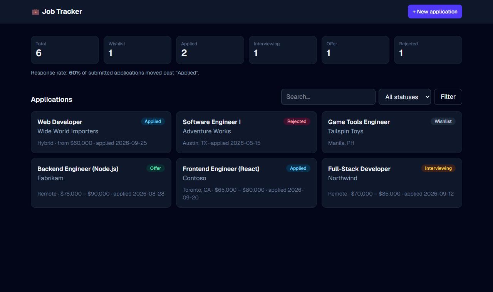

# Job application tracker (Next.js 16)

[](https://github.com/Nexude-ZainaV/nextjs-job-tracker/actions/workflows/ci.yml)


A tracker for job applications, from wishlist to offer. There's a
dashboard with counts and a response rate, search and status filters, and forms to
create, edit and delete. It uses the App Router, React Server Components, Server
Actions, Route Handlers and SQLite.



## What's in it

| Concept | Where |
|---|---|
| Server Components reading the database directly (no client fetch waterfall) | [src/app/page.tsx](src/app/page.tsx) |
| Server Actions with `useActionState` for inline errors and `useFormStatus` for pending state | [src/app/actions.ts](src/app/actions.ts), [src/components/JobForm.tsx](src/components/JobForm.tsx) |
| Progressive enhancement: forms and filters work before JavaScript loads | `JobForm`, the GET filter form |
| `revalidatePath` + `redirect` after mutations | `actions.ts` |
| REST API with Route Handlers (`201` + `Location`, `400`, `404`, `422`) | [src/app/api/jobs](src/app/api/jobs) |
| One Zod schema validating both form posts and JSON bodies | [src/lib/validation.ts](src/lib/validation.ts) |
| Typed routes: `PageProps<'/jobs/[id]'>`, `RouteContext<'/api/jobs/[id]'>`, async `params` | pages and route handlers |
| `notFound()`, custom `not-found.tsx`, `generateMetadata` | [src/app/jobs/[id]/page.tsx](src/app/jobs/%5Bid%5D/page.tsx) |
| `connection()` to render per request with a synchronous database driver | same file |
| Repository layer with parameterised SQL (`node:sqlite`) | [src/lib/jobs.ts](src/lib/jobs.ts) |

## Security notes

- Server Actions are public endpoints, so each one validates its own input instead of
  trusting the form.
- Job links must be `http:` or `https:`. A `javascript:` URL can never be saved and
  clicked later (stored XSS), and external links use `rel="noopener noreferrer"`.
- Every query uses bound parameters, and `LIKE` wildcards in searches are escaped.
- `import "server-only"` in the database module turns an accidental client import
  into a build error.
- Ids from the URL are parsed strictly (`parseId`), so `/jobs/abc` is a clean 404.

## REST API

```bash
curl -X POST localhost:3000/api/jobs -H "Content-Type: application/json" \
  -d '{"company":"Acme","role":"Frontend Engineer","status":"applied","salaryMin":65000}'

curl "localhost:3000/api/jobs?status=interview&q=remote"
curl -X PUT localhost:3000/api/jobs/1 -H "Content-Type: application/json" \
  -d '{"company":"Acme","role":"Frontend Engineer","status":"offer"}'
curl -X DELETE localhost:3000/api/jobs/1
```

Statuses: `wishlist`, `applied`, `interview`, `offer`, `rejected`.

## Run it

You need Node.js 22.13 or newer for the built-in `node:sqlite` module. Node prints an
"experimental" warning when it loads; that's expected.

```bash
npm install
npm run dev            # http://localhost:3000
```

Data is stored in `data/jobs.db`, which is git-ignored. Set `JOBS_DB_PATH` to put it
somewhere else.

| Script | What it does |
|---|---|
| `npm test` | Vitest: validation, repository and route handler tests on an in-memory database |
| `npm run typecheck` | generates route types, then `tsc --noEmit` |
| `npm run lint` | ESLint with the Next.js rules |
| `npm run build` | production build |

## Deploying

This runs anywhere with a writable disk that sticks around: a VPS, a container,
Railway, Fly.io. Serverless hosts such as Vercel have a read-only, short-lived
filesystem, so a SQLite file wouldn't persist there. To deploy on one, swap
`openDatabase` in [src/lib/db.ts](src/lib/db.ts) for a hosted database (Turso/libSQL,
Neon Postgres). The repository functions are the only other code that touches SQL.

## License

[MIT](LICENSE)
